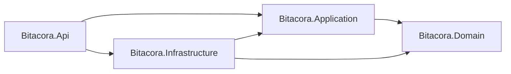

# Bitácora API — Tarea 2.2

API local de ASP.NET Core 10, EF Core y SQLite. El contrato se obtiene de los
controladores y DTO; openapi.json es una exportación de desarrollo. Regenerarlo
al cambiar endpoints. La colección Postman agrega aserciones manuales de contrato.

## Estructura y dependencias



- Domain: Registro, validaciones de negocio y excepción de validación. Sin referencias externas.
- Application: DTO de entrada/salida, IRegistroRepository y RegistroService con cinco casos de uso.
- Infrastructure: DbContext EF Core, repositorio SQLite y migración inicial.
- Api: controladores, inyección de dependencias, manejador global y documentación.

## Ejecución

Requiere SDK .NET 10. Desde la carpeta backend:

```bash
dotnet restore Bitacora.sln
dotnet tool restore
dotnet ef database update --project Bitacora.Infrastructure --startup-project Bitacora.Api
dotnet run --project Bitacora.Api -- --urls http://localhost:5000 --environment Development
```

- Swagger UI: http://localhost:5000/swagger
- OpenAPI: http://localhost:5000/openapi/v1.json
- Android Emulator: http://10.0.2.2:5000/ (su alias del host).
- SQLite: Bitacora.Api/bitacora.db, ignorada por Git. No se llama EnsureCreated:
  es necesario aplicar las migraciones antes de consultar.
- Conexión alternativa: variable ConnectionStrings__Bitacora con cadena SQLite.

Para cambios de esquema:

```bash
dotnet ef migrations add NombreDelCambio --project Bitacora.Infrastructure --startup-project Bitacora.Api
dotnet ef database update --project Bitacora.Infrastructure --startup-project Bitacora.Api
```

Las migraciones actualizan el esquema de forma versionada. Referencia:
[documentación de Microsoft](https://learn.microsoft.com/en-us/aspnet/core/data/ef-rp/migrations?view=aspnetcore-10.0).

## Contrato

| Método | Ruta | Respuesta |
| --- | --- | --- |
| GET | /api/registros | 200 con arreglo sin fotoBase64 |
| GET | /api/registros/{id} | 200 con detalle y foto, o 404 |
| POST | /api/registros | 201 con Location y detalle, o 400 |
| PUT | /api/registros/{id} | 200 con detalle, 400 o 404 |
| DELETE | /api/registros/{id} | 204 sin cuerpo, o 404 |

Id es entero autogenerado. FechaCreacion la asigna el servidor en UTC y se conserva
al editar. Los JSON usan camelCase. PUT reemplaza el registro; omitir fotoBase64
elimina la fotografía anterior. Listar proyecta DTO en SQL sin seleccionar la foto.

Ejemplo de entrada POST/PUT:

```json
{
  "titulo": "Observación de campo",
  "descripcion": "Descripción obtenida por voz",
  "fotoBase64": null
}
```

- Título obligatorio: de 3 a 100 caracteres; se recortan espacios al guardar y el
  valor recortado debe conservar al menos 3 caracteres.
- Descripción obligatoria y no compuesta solo de espacios; máximo 500 caracteres.
- Foto opcional (null o cadena vacía); Base64 sin prefijo data:. Máximo 2 MiB de
  contenido decodificado (2 097 152 bytes), no de la cadena codificada.
- Base64 válido no implica que sea una imagen decodificable; Android debe validar
  su decodificación y enviar JPEG reducido. La regla del enunciado valida Base64/tamaño.
- Entradas inválidas: 400 con ValidationProblemDetails y errors por campo.
- Error inesperado: 500 application/problem+json con mensaje genérico y traceId;
  el detalle técnico queda en logs del servidor.
- Accept no admitido: 406. Esto permite un caso fallido no destructivo para GET listado.

La extensión de tarea 2.5 protege los cinco endpoints con JWT. El login local de
laboratorio se describe al final; mantener el servidor local durante el desarrollo.

## Pruebas Postman

Importar ../postman/Bitacora.postman_collection.json y
../postman/Local.postman_environment.json. Seleccionar el entorno local y ejecutar
en orden: la colección crea un registro de prueba, reutiliza su ID y lo elimina.
El ID 2147483647 se reserva como inexistente en la base local de pruebas.

```bash
postman collection run ../postman/Bitacora.postman_collection.json -e ../postman/Local.postman_environment.json --no-report-events
```

Incluye éxito y fallo por cada endpoint, validación de campos y error 500.
La prueba 500 requiere Development y JWT. No hay credenciales reales en la colección.
La exportación de reporte --output del CLI disponible exige login; ejecutar sin
esa opción permite comprobar los resultados localmente sin publicarlos.

## Fallos controlados de desarrollo

Solo se registran en Development:

- GET /api/pruebas/demora: espera 15 segundos y responde un arreglo vacío.
- GET /api/pruebas/error: provoca una excepción para verificar el manejador global.

El laboratorio Android en debug permite seleccionar estas rutas para los tres
clientes. Usar JWT válido y timeout menor a 15000 ms para comprobar la demora.
Los tres clientes Android ya verificaron demora/timeout y HTTP 500.
Ver [matriz completa de 15 fallos](../docs/evidencias/LABORATORIO_FALLOS.md).
Las pruebas usaron timeout de 2000 ms frente a demora real de 15 segundos, JWT
válido y Development; no se modificaron registros. La API fue reiniciada después
del caso de servidor detenido y quedó disponible al terminar.

## Evidencias y pendientes

Ver ../docs/evidencias para salida de pruebas y ../docs/BASE_INFORME.md.
Pendientes: captura visual de Swagger/Postman, PDF, distribución real del trabajo,
participación/commits de cada integrante y entrega en GitHub. No atribuir autoría
ni revisión a compañeros que no hayan participado.


## Autenticación JWT del laboratorio (tarea 2.5)

El middleware JwtBearer valida firma HS256, emisor Bitacora.Laboratorio,
audiencia Bitacora.Android y vencimiento, con ClockSkew cero. Los cinco endpoints
CRUD y las dos rutas de fallos exigen Authorization: Bearer <token>.
Un token ausente/inválido/vencido devuelve 401 con desafío WWW-Authenticate Bearer.
Swagger define el esquema Bearer; usar Authorize con el token, sin escribir el prefijo.

POST /api/auth/login recibe username y password; devuelve accessToken,
expiresAtUtc y username. El token dura 15 minutos; no hay refresh automático.
El emisor es exclusivamente para las pruebas académicas locales en Development:
login devuelve 404 fuera de ese entorno. No implementa un proveedor OIDC de producción
ni pretende cubrir requisitos adicionales de la tarea 2.4 que no se han proporcionado.
La validación sigue la [documentación oficial de Microsoft](https://learn.microsoft.com/en-us/aspnet/core/security/authentication/configure-jwt-bearer-authentication?view=aspnetcore-10.0).

Al primer arranque Development se generan automáticamente:

- Bitacora.Api/.dev-auth.json: clave aleatoria y hash de contraseña con PasswordHasher.
- Bitacora.Api/.dev-login.json: usuario y contraseña para ingresar manualmente en Android.

Ambos archivos son locales, están excluidos de Git y usan permisos de usuario en
Unix. No copiarlos al informe ni a capturas. No contienen una contraseña compartida
por defecto: cada instalación genera la suya. No borrar estos archivos sin asumir
que cambiará la cuenta/clave y se invalidarán los tokens existentes.

No se registra el cuerpo del login. Los errores de credenciales son genéricos.
El endpoint limita a 20 intentos por IP/minuto. Responde Cache-Control: no-store.
Fuera de Development, Jwt:SigningKey debe venir de configuración del entorno;
el inicio falla si no hay una clave de al menos 32 bytes. No hay emisor de tokens
de producción en esta implementación de laboratorio.

### Postman con autenticación

La colección incluye login y conserva su token solo durante la ejecución.
Completar username/password en un entorno local privado; el export público
contiene valores vacíos. scripts/verify_jwt.py genera automáticamente el entorno
ignorado postman/Local.private.postman_environment.json y ejecuta la colección
sin publicar resultados. El token nunca se guarda en la colección versionada.

### Verificación agrupada

Desde la raíz del repositorio, con Pixel activo:

```bash
python3 scripts/verify_jwt.py
```

Compila API/Android, instala en Pixel, reinicia únicamente esta API local si ocupa
5000 y pertenece al proyecto, verifica rechazos 401 y acceso válido, ejecuta Postman
y comprueba login y los tres clientes reales de Android. Deja el backend activo.
Sus reportes no incluyen contraseñas ni tokens. Ver docs/evidencias/jwt-api.txt,
postman-api-jwt.txt y jwt-android.txt cuando la ejecución termine correctamente.
