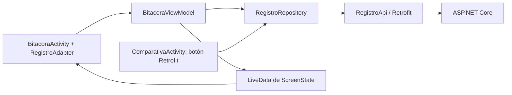
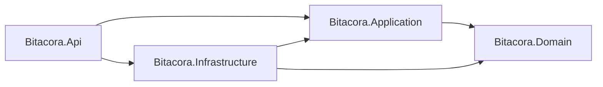

# Desarrollo y estructura de la aplicación

Actualizado: 12 de noviembre de 2026.

## Alcance actual

Proyecto creado desde cero para Bitácora de campo: backend de tarea 2.2,
cliente Android de tarea 2.3 y laboratorio comparativo de tarea 2.5.
El CRUD Android con MVVM y fotografía está implementado y probado localmente.
El flujo de voz está implementado, pero falta verificar un dictado con audio real.
JWT local y matriz de 15 fallos del laboratorio implementados y verificados.
Las 15 mediciones, el cuadro comparativo y la recomendación están documentados;
siguen pendientes los entregables y Git/PR revisado.

## Tecnologías

| Componente | Configuración |
| --- | --- |
| Android | Kotlin; vistas por código; minSdk 23, targetSdk 35, compileSdk 37 |
| Identidad | com.melvinpena.comparativa; versión 1.0 |
| Herramientas | AGP 9.4.1; Gradle Wrapper 9.7.1 |
| MVVM | AndroidX ComponentActivity, ViewModel, LiveData y RecyclerView |
| HTTP | Volley 1.2.1, OkHttp 4.12.0, Retrofit 2.11.0, Gson 2.11.0 |
| Backend | ASP.NET Core 10, EF Core 10 y SQLite |

## Organización

```text
app/src/main/
  AndroidManifest.xml
  java/com/melvinpena/comparativa/
    MainActivity.kt
    ComparativaActivity.kt
    UiStyle.kt
    ui/BitacoraActivity.kt
    viewmodel/BitacoraViewModel.kt
    viewmodel/ScreenState.kt
    data/remote/ApiClient.kt
    data/remote/RegistroApi.kt
    data/repository/RegistroRepository.kt
  res/xml/file_paths.xml
  res/xml/network_security_config.xml
app/src/debug/res/xml/network_security_config.xml
backend/
  Bitacora.sln
  Bitacora.Domain/
  Bitacora.Application/
  Bitacora.Infrastructure/
  Bitacora.Api/
  openapi.json
  README.md
postman/
  Bitacora.postman_collection.json
  Local.postman_environment.json
scripts/smoke_android_crud.py
docs/
  BASE_INFORME.md
  DESARROLLO_Y_ESTRUCTURA.md
  evidencias/
```

## Flujo de datos Android



### Interfaz

MainActivity presenta la portada y los accesos a Bitácora y Comparación.
UiStyle comparte colores, campos y botones. BitacoraActivity es una
ComponentActivity con tres modos: listado, detalle y formulario. Observa LiveData,
recibe eventos y lanza las aplicaciones externas de cámara y reconocimiento de voz.
El adaptador RecyclerView muestra título, descripción y fecha; pulsar una fila
consulta el detalle. Los márgenes respetan las barras del sistema.

El formulario sirve para crear y editar. Permite quitar fotografía y editar la
transcripción. Eliminar requiere confirmación; cancelar no envía DELETE.
Ninguna Activity construye Retrofit ni llama directamente a su interfaz de servicio.
El laboratorio conserva Volley y OkHttp directos por los objetivos de tarea 2.5.

### ViewModel y estado

BitacoraViewModel controla la navegación, lista, detalle y borrador. Expone
LiveData<ScreenState<BitacoraContent>>. Loading muestra ProgressBar y deshabilita
botones/campos; las filas ignoran eventos. Empty muestra una lista vacía explícita.
Success muestra datos. Error conserva el contexto y explica el fallo.

La validación exige título de 3–100 caracteres, descripción obligatoria de hasta
500 y fotografía de máximo 2 MiB decodificados. El criterio de espacios coincide
con el backend. Los errores 400 devueltos por el servidor también se muestran.
El ViewModel mantiene el borrador en recreaciones de Activity; onCleared cancela
la llamada activa y cierra el executor. No persiste borradores tras muerte del proceso.

Las lecturas con fallo de conexión/timeout permiten Reintentar. Tras un fallo de
escritura no se reenvía automáticamente: Reintentar permite revisar el listado o
confirmar un nuevo envío, porque el servidor pudo completar el primero.

### Acceso remoto

RegistroApi declara los cinco endpoints con GET, POST, PUT, DELETE, Path y Body.
DTO: RegistroResumen sin foto, RegistroDetalle con foto y RegistroInput para
POST/PUT. No se utilizan entidades EF ni JsonObject para el CRUD Retrofit.

RegistroRepository es la única clase Android que invoca RegistroApi. Expone
listar, consultar, crear, actualizar y eliminar; traduce HTTP/excepciones a
ApiResult y devuelve un RequestHandle cancelable. El botón Retrofit del laboratorio
reutiliza este mismo repositorio. La antigua interfaz raíz RegistrosApi fue retirada.

ApiClient centraliza Retrofit/Gson, connectTimeout, readTimeout y writeTimeout.
La URL se define una vez en BuildConfig.API_BASE_URL: http://10.0.2.2:5000/.
Ese host permite al emulador llegar al servidor local de la Mac. El logger BASIC
solo está activo en debug; redacta Authorization y excluye cuerpos/fotografías.
No se deben añadir secretos o datos privados a capturas.

Se reconocen 400 por campo, 401, 404 y 5xx; timeout, DNS/conexión, TLS y formato JSON.
Un fallo de conexión por sí solo no identifica si el servidor está detenido o si
el dispositivo perdió la red: las pruebas deben registrar su preparación real.

## Fotografía y voz

TakePicture recibe un URI de FileProvider limitado a cache/camera. El proveedor
no está exportado. La cámara externa guarda la imagen y el ViewModel procesa el
archivo fuera del hilo principal: muestreo al decodificar, reducción proporcional
a máximo 1024 px, JPEG con calidad 70 y verificación de 2 MiB antes de Base64 sin
saltos de línea. El archivo temporal se elimina tras procesarlo. La UI muestra
una vista previa; GET detalle permite decodificar la foto recuperada del servidor.

RecognizerIntent devuelve el primer resultado como descripción editable. Si falta
un reconocedor o no puede iniciarse, se muestra un mensaje. Se delega la captura
a aplicaciones externas; no se solicita acceso directo a cámara/micrófono.
El Pixel tiene un manejador de reconocimiento instalado, pero no se ha acreditado
un dictado con audio real. No confundir servicio disponible con transcripción probada.

## Backend y contrato



Domain contiene Registro y reglas; no depende de proyectos externos.
Application contiene DTO, IRegistroRepository y RegistroService con cinco casos de uso.
Infrastructure implementa EF Core SQLite, repositorio y migración InitialCreate.
Api contiene controladores, DI, manejador global y OpenAPI/Swagger.

| Operación | Endpoint | Respuesta |
| --- | --- | --- |
| Listar | GET /api/registros | 200; arreglo sin foto |
| Consultar | GET /api/registros/{id} | 200 con foto o 404 |
| Crear | POST /api/registros | 201 con Location o 400 |
| Actualizar | PUT /api/registros/{id} | 200, 400 o 404 |
| Eliminar | DELETE /api/registros/{id} | 204 o 404 |

ID entero autogenerado y fecha asignada por servidor. PUT reemplaza el contenido;
fotoBase64 ausente/null elimina la foto anterior. JSON camelCase, Base64 sin prefijo
data:. El listado proyecta SQL sin seleccionar la foto. Validación 400 con errores
por campo; excepciones 500 con ProblemDetails genérico y traceId sin detalle interno.

Solo Development publica Swagger/OpenAPI y rutas de prueba: /api/pruebas/demora
(15 s) y /api/pruebas/error (500 controlado). El selector debug del laboratorio
permite consultar ambas con los tres clientes. El CRUD y las rutas de prueba están protegidos con JWT; ver la extensión de acceso al final.

## Configuración y ejecución

El manifiesto declara INTERNET. HTTP está permitido solo hacia 10.0.2.2 en debug;
la configuración principal/release rechaza texto claro. local.properties contiene
la ruta local del SDK y no se publica. Git ignora bin, obj, bases SQLite y cachés.

Ejecutar migraciones y API según [backend/README.md](../backend/README.md).
Después:

```bash
./gradlew :app:assembleDebug
./gradlew :app:installDebug
adb shell am start -W -n com.melvinpena.comparativa/.MainActivity
```

En Android Studio, sincronizar Gradle y seleccionar app y dispositivo antes de Run.
Ejecutar por terminal no confirma una sesión de Apply Changes del IDE.

## Laboratorio: condiciones de comparación

Los tres clientes consultan el mismo GET y omiten Authorization si el token está
vacío. Volley usa JsonArrayRequest/getHeaders/DefaultRetryPolicy con cero reintentos
y sin caché. OkHttp usa Request manual, enqueue, Gson y runOnUiThread. Retrofit usa
el repositorio compartido y sus callbacks Android. Una consulta a la vez; cancelar
las pendientes al destruir la pantalla. Volley asigna tag antes de añadir a la cola.

Todos envían Cache-Control: no-cache, no-store. OkHttp/Retrofit no configuran caché
de disco y desactivan retryOnConnectionFailure; esto no garantiza el comportamiento
de proxies ni toda la pila de transporte. Utilizar URL final sin redirecciones:
OkHttp/Retrofit no las siguen; Volley conserva su transporte predeterminado.

El tiempo usa SystemClock.elapsedRealtime e incluye preparación, red, conversión
y entrega a UI. Volley reutiliza cola; OkHttp/Retrofit se construyen por consulta.
Timeout por socket en Volley y por conexión/lectura/escritura en OkHttp/Retrofit,
no límite total de extremo a extremo. Comparar esta implementación sin extrapolar
un ganador universal. Logcat ComparativaHTTP registra resultado/clase sin JWT/cuerpo.

## Verificación y evidencia

- Backend compilado sin errores/advertencias; migración generada/aplicada.
- Postman contra API local: 17 solicitudes, 25 aserciones, 0 fallos. Ver
  [salida](evidencias/postman-api-local.txt). Exportación --output requiere login;
  se guardó salida de consola sin publicar a la nube.
- Android compilado e instalado en Pixel 4 XL. CRUD desde UI y persistencia real:
  [resultado](evidencias/android-crud-smoke.txt). Incluye validación local,
  crear/editar, listado/detalle, cancelar y confirmar eliminación.
- Cámara del emulador, procesamiento y envío/recuperación Base64:
  [resultado](evidencias/android-fotografia.txt). JPEG 768×1024, 13 234 bytes.
  Registro de prueba eliminado desde Android.
- Desconexión con modo avión y Wi-Fi desactivado, error/Reintentar y recuperación:
  [resultado](evidencias/android-conexion.txt). La red fue restaurada.
- API detenida y reiniciada: ver [resultado](evidencias/android-api-detenida.txt).
- Capturas en evidencias y [Logcat HTTP](evidencias/android-http-logcat.txt).
  La carpeta depuracion conserva una captura de un fallo previo del script de
  automatización; no es el resultado final ni evidencia de fallo del CRUD.

Prueba reutilizable: `python3 scripts/smoke_android_crud.py`, con API y emulador
activos. Crea un registro único y lo elimina al completar; si falla informa el ID.
Verifica UI y datos del backend. No automatiza voz, foto, JWT ni los quince casos 2.5.

## Historial y pendientes

Se corrigió la falta de Gradle Wrapper tras un fallo de sincronización del IDE con
Gradle 9.3.0; Wrapper 9.7.1 compila. Persisten advertencias de APIs visuales obsoletas
que no bloquean compilación. Luego se corrigió el laboratorio, se documentó el
alcance, se creó la API en cuatro capas y se implementó el cliente MVVM compartido.
Los primeros fallos de automatización se debían a selección de texto y comparación
de mayúsculas de botones; el recorrido final pasó después de corregir el script.

Pendientes de tarea 2.5: PDF, video, commits/push en rama personal y PR revisado
por un compañero. La matriz de fallos, mediciones, comparación y recomendación están completas.
Dictado real, orientación EXIF y persistencia tras muerte del proceso quedan fuera
del alcance actual de tarea 2.5. No atribuir pruebas ni participación no realizadas.


## Extensión JWT y acceso Android

Esta sección sustituye las referencias anteriores a JWT pendiente de implementación.
El alcance es un emisor local de pruebas académicas en Development.

### API

- LabAuthentication: crea cuenta local aleatoria, hash PasswordHasher y clave de
  firma fuera de Git; emite JWT HS256 de 15 minutos.
- AuthController: POST /api/auth/login, credenciales genéricas, sin caché y con
  límite de 20 intentos/IP/minuto. Login no está disponible en Production.
- JwtBearer en Program: valida firma, algoritmo, emisor, audiencia y expiración.
- Authorize en RegistrosController y RequireAuthorization en rutas de prueba.
- JwtOpenApi: esquema Bearer y respuesta 401 en operaciones protegidas.
- Las credenciales reales se consultan solo en backend/Bitacora.Api/.dev-login.json.
  No se deben copiar a evidencia; el hash y clave viven en .dev-auth.json.

### Android

- data/remote/AuthApi.kt: DTO LoginInput/LoginReply y contrato de acceso.
- data/remote/AuthSession.kt: token y usuario solo en memoria. Requiere nuevo login
  tras muerte del proceso; no se guardan en preferencias ni se decodifica el JWT.
- data/repository/AuthRepository.kt: invoca el login Retrofit y abre la sesión.
- viewmodel/LoginViewModel.kt: carga, éxito, error y cancelación del acceso.
- ui/LoginActivity.kt: formulario con contraseña oculta; FLAG_SECURE evita capturas
  de credenciales y no se guarda la contraseña como estado de vista.
- MainActivity: acciones Iniciar/Cerrar sesión.
- RegistroRepository: si no se proporciona token explícito, usa la sesión actual
  en cada operación; un token explícito vacío sigue omitiendo el encabezado para
  poder probar 401 en el laboratorio.
- ComparativaActivity: precarga el mismo token de sesión en el campo oculto que
  usan Volley, OkHttp y Retrofit. Se puede borrar para el caso sin autenticación.

El servidor decide si el token está vencido. Un 401 se muestra en pantalla sin
reintentar automáticamente ni ocultarlo mediante renovación. Cerrar sesión borra
la referencia en memoria; no revoca tokens emitidos, que siguen válidos hasta expirar.
El transporte HTTP hacia 10.0.2.2 sigue limitado a debug; el login es local de prueba.

### Pruebas reproducibles

scripts/verify_jwt.py agrupa compilaciones, instalación, reinicio de esta API,
pruebas de token y ejecución de Postman más UI del laboratorio. No borra registros
del usuario ni imprime claves. Valida 401 con token ausente, malformado, alterado,
vencido, emisor y audiencia incorrectos; comprueba acceso válido y los tres clientes.
Los resultados finales se registran en evidencias/jwt-api.txt, jwt-android.txt y
postman-api-jwt.txt. El script de smoke CRUD también inicia sesión y autentica sus
consultas de comprobación después de esta extensión.


Resultado final JWT: API/Android compilados e instalados correctamente; 15
verificaciones API, colección Postman de 20 solicitudes/29 aserciones sin fallos,
y seis comprobaciones en el laboratorio Android: éxito autenticado y 401 sin
encabezado para cada uno de los tres clientes. Reportes en jwt-api.txt,
jwt-android.txt y postman-api-jwt.txt. No se imprimieron contraseñas ni tokens.
La clave y credenciales privadas se verificaron como ignoradas por Git.

El script agrupado deja la API activa y la app en la portada con sesión en memoria.
Las primeras verificaciones detectaron una incompatibilidad de tipos en el
transformador OpenAPI y que el proveedor de archivos de configuración excluía
archivos con prefijo punto; se corrigieron antes de obtener el resultado final.
El archivo privado se carga explícitamente con AddJsonStream.

## Selector de escenarios y pruebas realizadas

En ComparativaActivity se agregó un Spinner con rutas fijas definidas en
`data/remote/EscenarioLaboratorio.kt`:

| Selección | Ruta GET | Resultado esperado |
| --- | --- | --- |
| Listado normal | /api/registros | Arreglo de registros |
| Tiempo de espera | /api/pruebas/demora | Demora de 15 segundos, superior al timeout de prueba |
| Error interno | /api/pruebas/error | HTTP 500 controlado |

Volley y OkHttp construyen la URL con la ruta seleccionada. Retrofit llama
`RegistroRepository.consultarLaboratorio`; el caso normal delega en `listar`
y los otros usan `RegistroApi.consultarLaboratorio` con `@Url` y `@Header`.
Los tres conservan JWT y timeout configurados. URL, JWT, timeout y selector quedan
bloqueados durante una solicitud. Logcat incluye escenario y error, sin JWT ni cuerpos.
Release ofrece solo listado normal; el backend registra las rutas de fallo
exclusivamente en Development y exige autenticación.

Verificación ejecutada: `./gradlew :app:assembleDebug`, `./gradlew :app:installDebug`
y `dotnet build backend/Bitacora.sln`. Compilación e instalación correctas.
Los 15 fallos se ejecutaron con timeout de 2000 ms y JWT válido salvo el caso 401.
El 401 documentado en Android corresponde a token ausente; la expiración también
se probó en API durante la fase JWT, sin atribuirla a esta matriz Android.

[Tabla completa de fallos, capturas y Logcat](evidencias/LABORATORIO_FALLOS.md).
Datos estructurados: `evidencias/laboratorio-fallos.json`.
Script reproducible: `scripts/verify_lab_failures.py`; requiere APK instalada,
emulador, backend compilado y puerto 5000 libre. Deja su API activa y restaura la red.
No modifica registros. Se comprobó resultado visible, actividad de laboratorio
y conservación del PID, sin cierre inesperado en los 15 casos.

La primera automatización falló al seleccionar un botón por la evaluación de un
nodo XML; se corrigió el script antes de guardar resultados. La evidencia inicial
de red se tomó durante la transición de modo avión: se repitieron únicamente
esos tres casos tras confirmar ausencia de red predeterminada activa. Las capturas
y Logcat actuales corresponden a las ejecuciones finales. Las horas de Logcat
pertenecen al reloj del emulador. La red quedó restaurada (avión 0, Wi-Fi 1).

## Punto de continuación — pendientes de tarea 2.5

Estado actualizado al 12 de noviembre de 2026.

### Completado

- [x] Laboratorio con Volley, OkHttp y Retrofit, JWT, cantidad y duración.
- [x] Retrofit reutiliza RegistroRepository del CRUD.
- [x] Selector de listado, demora y HTTP 500 compartido por los tres clientes.
- [x] Rutas de fallos limitadas a Development; selector de fallos solo en debug.
- [x] Compilación API sin errores ni advertencias e instalación debug en Pixel 4 XL.
- [x] Cinco escenarios por cliente: 15 casos con captura y Logcat, sin cierre.
- [x] Red restaurada y API reiniciada después de las pruebas.

### Pendientes en orden

- [x] Realizar cinco consultas exitosas por cliente: 15 mediciones con el mismo
  endpoint, JWT válido, dispositivo, datos, timeout y condiciones de red.
- [x] Calcular promedios y completar cuadro comparativo: conteo de líneas con
  criterio explícito, encabezados, JSON, hilo, errores, reintentos/timeouts y mantenimiento.
- [x] Redactar recomendación final con resultados reales.
- [x] Ordenar rama personal según el enunciado: feature/comparativa-melvin-pena.
  Se conserva el historial previo y se incorpora main sin reescribir commits.
- [x] Publicar y verificar commits de selector, pruebas, evidencias y documentación.
- [x] Abrir PR de continuación hacia main: [PR #4](https://github.com/meledpeca93/Tarea2.5-Volley-OkHttp-Retrofit/pull/4).
- [ ] Obtener revisión real de otro integrante antes de integrar el PR #4.
  El PR #3 anterior ya fue integrado; resolver conflictos no acredita revisión.
- [x] Generar PDF individual con tabla comparativa, matriz de fallos y evidencias.
- [ ] Revisión final del PDF por el estudiante antes de entregar.
- [ ] Grabar video individual de 3–4 minutos, cámara encendida, explicación de
  Volley/OkHttp y demostración de al menos dos fallos.
- [ ] Verificar enlaces y archivos finales para entregar el 13 de noviembre a las 23:59.

### Cómo retomar

1. Comprobar API y emulador; no repetir fallos ya verificados salvo cambios o dudas.
2. Iniciar sesión si el token de 15 minutos venció. Consultar credenciales solo
   en backend/Bitacora.Api/.dev-login.json, sin publicarlas ni modificar su contraseña.
3. Continuar con rama/commits/PR revisado y preparación del PDF y video.
   Las 15 mediciones exitosas ya están guardadas; no repetirlas salvo cambios o dudas.
4. Declarar el orden y las condiciones; excluir tiempos fallidos de los promedios.

Dictado real, orientación EXIF y persistencia de sesión son asuntos de tarea 2.3
fuera del alcance actual. No bloquean los siguientes pasos de la tarea 2.5.

## Mediciones exitosas completadas (12 de noviembre de 2026)

Se realizaron cinco consultas autenticadas de listado por cliente, en cinco
rondas Volley → OkHttp → Retrofit, timeout de 2000 ms, mismo emulador y datos.
No se ejecutó calentamiento del listado en este proceso; el login ocurrió antes.
La API ya estaba activa por las pruebas anteriores. Los datos conservaron el mismo
contenido antes y después. No se añadieron ni eliminaron registros de prueba.

[Metodología, quince muestras, promedios y evidencias](evidencias/LABORATORIO_MEDICIONES.md).
Script: `scripts/measure_lab_clients.py`. La app conservó su PID en toda la serie.
Estos promedios describen esta implementación y este conjunto de datos; no
establecen una clasificación universal de las librerías.
Conteo de líneas, valoración de mantenimiento y recomendación final completados.
Los siguientes pasos son revisar el PDF generado, grabar el video y obtener revisión del PR.

## Cuadro comparativo y recomendación completados

La base del informe contiene la comparación final de encabezados, JSON, hilos,
errores, reintentos, timeouts, pruebas, mantenimiento y promedios medidos.
Conteo reproducible: `python3 scripts/count_lab_lines.py`; adaptadores de Activity:
Volley 26, OkHttp 42 y Retrofit 18 líneas, con soporte compartido informado aparte.
Se recomienda Retrofit por DTO, repositorio reutilizado y errores centralizados;
Volley obtuvo el menor promedio de esta serie. No se infiere rendimiento general.
La recomendación declara arreglo vacío, creación de clientes por consulta y
logging BASIC de Retrofit en debug como límites de las mediciones.

Ver [informe individual](BASE_INFORME.md) y
[conteo de líneas](evidencias/laboratorio-lineas.json).
Próximo paso: obtener revisión del PR, revisar el PDF generado y grabar el video individual.

## Publicación Git verificada — 12 de noviembre de 2026

Rama: `feature/comparativa-melvin-pena`, publicada en origin sin force push.
La rama ya existía; se actualizó con fast-forward conservando el historial.
Los conflictos resueltos por el estudiante en el PR #3 ya estaban en main;
se incorporaron antes de preparar los cambios nuevos.

Commits de esta continuación:

- `c0ff331`: selector de escenarios compartidos en laboratorio HTTP.
- `dcee07d`: scripts, quince fallos y quince mediciones con sus evidencias.
- `8654ba5`: cuadro comparativo, recomendación y documentación actualizada.

PR abierto hacia main: [#4](https://github.com/meledpeca93/Tarea2.5-Volley-OkHttp-Retrofit/pull/4).
El PR #3 anterior está integrado. El PR #4 queda abierto para revisión real de
otro integrante; no se atribuye aprobación ni participación aún no realizadas.
La actualización del enlace del PR se guarda en un commit adicional de documentación.

Verificación: diff sin errores de espacios, credenciales locales ignoradas y
ausencia de JWT completos en los archivos de texto revisados. Las pruebas Android
y backend documentadas se conservan; no se repitieron al cambiar solo documentación.
Pendientes de entrega: revisión del compañero, revisión final del PDF y video individual.

## PDF individual generado — 12 de noviembre de 2026

Archivo en la raíz: [Informe_Tarea_2_5_Melvin_Pena.pdf](../Informe_Tarea_2_5_Melvin_Pena.pdf).
Contiene 11 páginas: portada, implementación, metodología y cinco mediciones por
cliente, cuadro comparativo completo, conteo de líneas, los cinco escenarios
con sus quince capturas y extractos de Logcat, recomendación final y trazabilidad
de Git/PR. Los resultados se leen de los JSON de evidencias; no se inventan mediciones.

La portada usa el nombre disponible, Melvin Peña. El informe declara listado vacío,
diferencias de creación de clientes y logging debug; no afirma revisión del
compañero ni realización del video. No incluye credenciales ni JWT completos.

Generador reproducible: `scripts/generate_report_pdf.py`, requiere Python con
ReportLab y Pillow. Ejecutar desde la raíz: `python3 scripts/generate_report_pdf.py`.
Se revisaron visualmente las once páginas, la integridad de las tablas, las quince
capturas y los textos dentro de los límites de página. Tamaño aproximado: 3,59 MiB.
El PDF se deja local para que el estudiante lo revise; no se publica automáticamente.
Pendientes actuales: revisión final del PDF, revisión del compañero y video individual.

## Registros de demostración para el laboratorio

La API estaba vacía después de las pruebas que eliminaban sus propios datos.
Se agregaron tres registros ficticios con títulos Demostración: observación de
flora, Demostración: punto de agua y Demostración: recorrido de campo.
El script `scripts/seed_demo_records.py` los crea si no existen, sin duplicarlos
ni modificar/eliminar registros existentes; requiere API local activa.

En Android, iniciar sesión y seleccionar Listado normal para que los tres
clientes consulten /api/registros y muestren la cantidad actual. Para ver los
títulos y detalles, abrir la bitácora de campo. El laboratorio muestra cantidad
y tiempo, como exige la tarea; el endpoint de demora devuelve un arreglo vacío
por diseño. También se pueden crear registros desde Abrir bitácora de campo →
Nuevo registro → Guardar en el servidor.

Estos datos se agregaron después de las mediciones: el PDF y las quince muestras
originales siguen describiendo correctamente el listado de cero registros de
aquella serie. Los datos de demostración no se presentan como una repetición
de las mediciones ni cambian sus promedios.

Verificación desde Android: Volley, OkHttp y Retrofit mostraron 3 registros.
[Logcat de demostración](evidencias/laboratorio-datos-demo.txt); capturas
lab-demo-volley.png, lab-demo-okhttp.png y lab-demo-retrofit.png en evidencias.

## Video guía demostrativo — 13 de noviembre de 2026

Generado localmente: [Video_Guia_Tarea_2_5_Melvin_Pena.mp4](../Video_Guia_Tarea_2_5_Melvin_Pena.mp4).
Duración: 3 minutos 55 segundos; 1920×1080, H.264/AAC, narración sintética
en español. Incluye código real de Volley, JWT, OkHttp y Retrofit y grabaciones
reales del emulador con la interfaz actual: listado con los tres clientes,
timeout con Volley/OkHttp, HTTP 500 con ambos y recuperación con Retrofit.
El login se realizó antes de grabar; no se muestran credenciales ni JWT completos.

La captura actual mostró 4 registros; no se modificaron datos durante el video.
Las mediciones originales con cero registros y sus promedios se mantienen.
El recorrido Android se acelera para ajustarse al tiempo del ejemplo y se
identifica en pantalla. El video es una guía para replicar, no acredita la
explicación individual con cámara exigida por la tarea.

Guion con capítulos: docs/GUION_VIDEO_DEMOSTRATIVO.md.
Verificación de las peticiones: docs/evidencias/video-demostracion-logcat.txt.
Generadores: scripts/record_android_demo.py y scripts/generate_demo_video.py.
Se revisaron fotogramas, resolución, duración y presencia de audio.
Video, guion y cambios nuevos permanecen locales; no se publican automáticamente.

El video guía se regeneró con resaltado de sintaxis Kotlin y leyenda visual:
palabras clave en violeta, tipos en turquesa, funciones en amarillo, textos en
verde y números en naranja. Se conserva la grabación real de Android y el audio.
El generador usa Pygments para resaltar los fragmentos de código originales.
