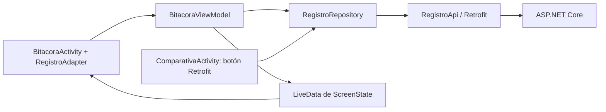
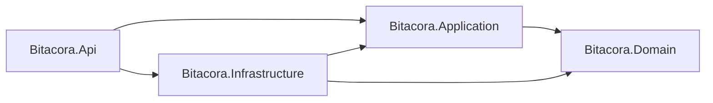

# Desarrollo y estructura de la aplicación

Actualizado: 11 de noviembre de 2026.

## Alcance actual

Proyecto creado desde cero para Bitácora de campo: backend de tarea 2.2,
cliente Android de tarea 2.3 y laboratorio comparativo de tarea 2.5.
El CRUD Android con MVVM y fotografía está implementado y probado localmente.
El flujo de voz está implementado, pero falta verificar un dictado con audio real.
JWT local está implementado y verificado; la matriz completa de pruebas 2.5 sigue pendiente.

## Tecnologías

| Componente | Configuración |
| --- | --- |
| Android | Kotlin; vistas por código; minSdk 23, targetSdk 35, compileSdk 37 |
| Identidad | com.melvinpena.comparativa; versión 1.0 |
| Herramientas | AGP 9.4.1; Gradle Wrapper 9.7.1 |
| MVVM | AndroidX ComponentActivity, ViewModel, LiveData y RecyclerView |
| HTTP | Volley 1.2.1, OkHttp 4.12.0, Retrofit 2.11.0, Gson 2.11.0 |
| Backend | ASP.NET Core 10, EF Core 10 y SQLite |

## Organización

```text
app/src/main/
  AndroidManifest.xml
  java/com/melvinpena/comparativa/
    MainActivity.kt
    ComparativaActivity.kt
    UiStyle.kt
    ui/BitacoraActivity.kt
    viewmodel/BitacoraViewModel.kt
    viewmodel/ScreenState.kt
    data/remote/ApiClient.kt
    data/remote/RegistroApi.kt
    data/repository/RegistroRepository.kt
  res/xml/file_paths.xml
  res/xml/network_security_config.xml
app/src/debug/res/xml/network_security_config.xml
backend/
  Bitacora.sln
  Bitacora.Domain/
  Bitacora.Application/
  Bitacora.Infrastructure/
  Bitacora.Api/
  openapi.json
  README.md
postman/
  Bitacora.postman_collection.json
  Local.postman_environment.json
scripts/smoke_android_crud.py
docs/
  BASE_INFORME.md
  DESARROLLO_Y_ESTRUCTURA.md
  evidencias/
```

## Flujo de datos Android



### Interfaz

MainActivity presenta la portada y los accesos a Bitácora y Comparación.
UiStyle comparte colores, campos y botones. BitacoraActivity es una
ComponentActivity con tres modos: listado, detalle y formulario. Observa LiveData,
recibe eventos y lanza las aplicaciones externas de cámara y reconocimiento de voz.
El adaptador RecyclerView muestra título, descripción y fecha; pulsar una fila
consulta el detalle. Los márgenes respetan las barras del sistema.

El formulario sirve para crear y editar. Permite quitar fotografía y editar la
transcripción. Eliminar requiere confirmación; cancelar no envía DELETE.
Ninguna Activity construye Retrofit ni llama directamente a su interfaz de servicio.
El laboratorio conserva Volley y OkHttp directos por los objetivos de tarea 2.5.

### ViewModel y estado

BitacoraViewModel controla la navegación, lista, detalle y borrador. Expone
LiveData<ScreenState<BitacoraContent>>. Loading muestra ProgressBar y deshabilita
botones/campos; las filas ignoran eventos. Empty muestra una lista vacía explícita.
Success muestra datos. Error conserva el contexto y explica el fallo.

La validación exige título de 3–100 caracteres, descripción obligatoria de hasta
500 y fotografía de máximo 2 MiB decodificados. El criterio de espacios coincide
con el backend. Los errores 400 devueltos por el servidor también se muestran.
El ViewModel mantiene el borrador en recreaciones de Activity; onCleared cancela
la llamada activa y cierra el executor. No persiste borradores tras muerte del proceso.

Las lecturas con fallo de conexión/timeout permiten Reintentar. Tras un fallo de
escritura no se reenvía automáticamente: Reintentar permite revisar el listado o
confirmar un nuevo envío, porque el servidor pudo completar el primero.

### Acceso remoto

RegistroApi declara los cinco endpoints con GET, POST, PUT, DELETE, Path y Body.
DTO: RegistroResumen sin foto, RegistroDetalle con foto y RegistroInput para
POST/PUT. No se utilizan entidades EF ni JsonObject para el CRUD Retrofit.

RegistroRepository es la única clase Android que invoca RegistroApi. Expone
listar, consultar, crear, actualizar y eliminar; traduce HTTP/excepciones a
ApiResult y devuelve un RequestHandle cancelable. El botón Retrofit del laboratorio
reutiliza este mismo repositorio. La antigua interfaz raíz RegistrosApi fue retirada.

ApiClient centraliza Retrofit/Gson, connectTimeout, readTimeout y writeTimeout.
La URL se define una vez en BuildConfig.API_BASE_URL: http://10.0.2.2:5000/.
Ese host permite al emulador llegar al servidor local de la Mac. El logger BASIC
solo está activo en debug; redacta Authorization y excluye cuerpos/fotografías.
No se deben añadir secretos o datos privados a capturas.

Se reconocen 400 por campo, 401, 404 y 5xx; timeout, DNS/conexión, TLS y formato JSON.
Un fallo de conexión por sí solo no identifica si el servidor está detenido o si
el dispositivo perdió la red: las pruebas deben registrar su preparación real.

## Fotografía y voz

TakePicture recibe un URI de FileProvider limitado a cache/camera. El proveedor
no está exportado. La cámara externa guarda la imagen y el ViewModel procesa el
archivo fuera del hilo principal: muestreo al decodificar, reducción proporcional
a máximo 1024 px, JPEG con calidad 70 y verificación de 2 MiB antes de Base64 sin
saltos de línea. El archivo temporal se elimina tras procesarlo. La UI muestra
una vista previa; GET detalle permite decodificar la foto recuperada del servidor.

RecognizerIntent devuelve el primer resultado como descripción editable. Si falta
un reconocedor o no puede iniciarse, se muestra un mensaje. Se delega la captura
a aplicaciones externas; no se solicita acceso directo a cámara/micrófono.
El Pixel tiene un manejador de reconocimiento instalado, pero no se ha acreditado
un dictado con audio real. No confundir servicio disponible con transcripción probada.

## Backend y contrato



Domain contiene Registro y reglas; no depende de proyectos externos.
Application contiene DTO, IRegistroRepository y RegistroService con cinco casos de uso.
Infrastructure implementa EF Core SQLite, repositorio y migración InitialCreate.
Api contiene controladores, DI, manejador global y OpenAPI/Swagger.

| Operación | Endpoint | Respuesta |
| --- | --- | --- |
| Listar | GET /api/registros | 200; arreglo sin foto |
| Consultar | GET /api/registros/{id} | 200 con foto o 404 |
| Crear | POST /api/registros | 201 con Location o 400 |
| Actualizar | PUT /api/registros/{id} | 200, 400 o 404 |
| Eliminar | DELETE /api/registros/{id} | 204 o 404 |

ID entero autogenerado y fecha asignada por servidor. PUT reemplaza el contenido;
fotoBase64 ausente/null elimina la foto anterior. JSON camelCase, Base64 sin prefijo
data:. El listado proyecta SQL sin seleccionar la foto. Validación 400 con errores
por campo; excepciones 500 con ProblemDetails genérico y traceId sin detalle interno.

Solo Development publica Swagger/OpenAPI y rutas de prueba: /api/pruebas/demora
(15 s) y /api/pruebas/error (500 controlado). Falta integrar selección de estas
rutas en el laboratorio. El CRUD y las rutas de prueba están protegidos con JWT; ver la extensión de acceso al final.

## Configuración y ejecución

El manifiesto declara INTERNET. HTTP está permitido solo hacia 10.0.2.2 en debug;
la configuración principal/release rechaza texto claro. local.properties contiene
la ruta local del SDK y no se publica. Git ignora bin, obj, bases SQLite y cachés.

Ejecutar migraciones y API según [backend/README.md](../backend/README.md).
Después:

```bash
./gradlew :app:assembleDebug
./gradlew :app:installDebug
adb shell am start -W -n com.melvinpena.comparativa/.MainActivity
```

En Android Studio, sincronizar Gradle y seleccionar app y dispositivo antes de Run.
Ejecutar por terminal no confirma una sesión de Apply Changes del IDE.

## Laboratorio: condiciones de comparación

Los tres clientes consultan el mismo GET y omiten Authorization si el token está
vacío. Volley usa JsonArrayRequest/getHeaders/DefaultRetryPolicy con cero reintentos
y sin caché. OkHttp usa Request manual, enqueue, Gson y runOnUiThread. Retrofit usa
el repositorio compartido y sus callbacks Android. Una consulta a la vez; cancelar
las pendientes al destruir la pantalla. Volley asigna tag antes de añadir a la cola.

Todos envían Cache-Control: no-cache, no-store. OkHttp/Retrofit no configuran caché
de disco y desactivan retryOnConnectionFailure; esto no garantiza el comportamiento
de proxies ni toda la pila de transporte. Utilizar URL final sin redirecciones:
OkHttp/Retrofit no las siguen; Volley conserva su transporte predeterminado.

El tiempo usa SystemClock.elapsedRealtime e incluye preparación, red, conversión
y entrega a UI. Volley reutiliza cola; OkHttp/Retrofit se construyen por consulta.
Timeout por socket en Volley y por conexión/lectura/escritura en OkHttp/Retrofit,
no límite total de extremo a extremo. Comparar esta implementación sin extrapolar
un ganador universal. Logcat ComparativaHTTP registra resultado/clase sin JWT/cuerpo.

## Verificación y evidencia

- Backend compilado sin errores/advertencias; migración generada/aplicada.
- Postman contra API local: 17 solicitudes, 25 aserciones, 0 fallos. Ver
  [salida](evidencias/postman-api-local.txt). Exportación --output requiere login;
  se guardó salida de consola sin publicar a la nube.
- Android compilado e instalado en Pixel 4 XL. CRUD desde UI y persistencia real:
  [resultado](evidencias/android-crud-smoke.txt). Incluye validación local,
  crear/editar, listado/detalle, cancelar y confirmar eliminación.
- Cámara del emulador, procesamiento y envío/recuperación Base64:
  [resultado](evidencias/android-fotografia.txt). JPEG 768×1024, 13 234 bytes.
  Registro de prueba eliminado desde Android.
- Desconexión con modo avión y Wi-Fi desactivado, error/Reintentar y recuperación:
  [resultado](evidencias/android-conexion.txt). La red fue restaurada.
- API detenida y reiniciada: ver [resultado](evidencias/android-api-detenida.txt).
- Capturas en evidencias y [Logcat HTTP](evidencias/android-http-logcat.txt).
  La carpeta depuracion conserva una captura de un fallo previo del script de
  automatización; no es el resultado final ni evidencia de fallo del CRUD.

Prueba reutilizable: `python3 scripts/smoke_android_crud.py`, con API y emulador
activos. Crea un registro único y lo elimina al completar; si falla informa el ID.
Verifica UI y datos del backend. No automatiza voz, foto, JWT ni los quince casos 2.5.

## Historial y pendientes

Se corrigió la falta de Gradle Wrapper tras un fallo de sincronización del IDE con
Gradle 9.3.0; Wrapper 9.7.1 compila. Persisten advertencias de APIs visuales obsoletas
que no bloquean compilación. Luego se corrigió el laboratorio, se documentó el
alcance, se creó la API en cuatro capas y se implementó el cliente MVVM compartido.
Los primeros fallos de automatización se debían a selección de texto y comparación
de mayúsculas de botones; el recorrido final pasó después de corregir el script.

Pendientes: dictado real, orientación EXIF, persistencia tras muerte del proceso,
JWT, matriz completa de fallos/mediciones 2.5, PDF, videos, commits en rama personal
y PR revisado por un compañero. No atribuir pruebas ni participación no realizadas.


## Extensión JWT y acceso Android

Esta sección sustituye las referencias anteriores a JWT pendiente de implementación.
El alcance es un emisor local de pruebas académicas en Development.

### API

- LabAuthentication: crea cuenta local aleatoria, hash PasswordHasher y clave de
  firma fuera de Git; emite JWT HS256 de 15 minutos.
- AuthController: POST /api/auth/login, credenciales genéricas, sin caché y con
  límite de 20 intentos/IP/minuto. Login no está disponible en Production.
- JwtBearer en Program: valida firma, algoritmo, emisor, audiencia y expiración.
- Authorize en RegistrosController y RequireAuthorization en rutas de prueba.
- JwtOpenApi: esquema Bearer y respuesta 401 en operaciones protegidas.
- Las credenciales reales se consultan solo en backend/Bitacora.Api/.dev-login.json.
  No se deben copiar a evidencia; el hash y clave viven en .dev-auth.json.

### Android

- data/remote/AuthApi.kt: DTO LoginInput/LoginReply y contrato de acceso.
- data/remote/AuthSession.kt: token y usuario solo en memoria. Requiere nuevo login
  tras muerte del proceso; no se guardan en preferencias ni se decodifica el JWT.
- data/repository/AuthRepository.kt: invoca el login Retrofit y abre la sesión.
- viewmodel/LoginViewModel.kt: carga, éxito, error y cancelación del acceso.
- ui/LoginActivity.kt: formulario con contraseña oculta; FLAG_SECURE evita capturas
  de credenciales y no se guarda la contraseña como estado de vista.
- MainActivity: acciones Iniciar/Cerrar sesión.
- RegistroRepository: si no se proporciona token explícito, usa la sesión actual
  en cada operación; un token explícito vacío sigue omitiendo el encabezado para
  poder probar 401 en el laboratorio.
- ComparativaActivity: precarga el mismo token de sesión en el campo oculto que
  usan Volley, OkHttp y Retrofit. Se puede borrar para el caso sin autenticación.

El servidor decide si el token está vencido. Un 401 se muestra en pantalla sin
reintentar automáticamente ni ocultarlo mediante renovación. Cerrar sesión borra
la referencia en memoria; no revoca tokens emitidos, que siguen válidos hasta expirar.
El transporte HTTP hacia 10.0.2.2 sigue limitado a debug; el login es local de prueba.

### Pruebas reproducibles

scripts/verify_jwt.py agrupa compilaciones, instalación, reinicio de esta API,
pruebas de token y ejecución de Postman más UI del laboratorio. No borra registros
del usuario ni imprime claves. Valida 401 con token ausente, malformado, alterado,
vencido, emisor y audiencia incorrectos; comprueba acceso válido y los tres clientes.
Los resultados finales se registran en evidencias/jwt-api.txt, jwt-android.txt y
postman-api-jwt.txt. El script de smoke CRUD también inicia sesión y autentica sus
consultas de comprobación después de esta extensión.


Resultado final JWT: API/Android compilados e instalados correctamente; 15
verificaciones API, colección Postman de 20 solicitudes/29 aserciones sin fallos,
y seis comprobaciones en el laboratorio Android: éxito autenticado y 401 sin
encabezado para cada uno de los tres clientes. Reportes en jwt-api.txt,
jwt-android.txt y postman-api-jwt.txt. No se imprimieron contraseñas ni tokens.
La clave y credenciales privadas se verificaron como ignoradas por Git.

El script agrupado deja la API activa y la app en la portada con sesión en memoria.
Las primeras verificaciones detectaron una incompatibilidad de tipos en el
transformador OpenAPI y que el proveedor de archivos de configuración excluía
archivos con prefijo punto; se corrigieron antes de obtener el resultado final.
El archivo privado se carga explícitamente con AddJsonStream.

## Punto de continuación — pendientes de tarea 2.5

Estado al pausar el trabajo, 11 de noviembre de 2026. Retomar esta noche desde
esta lista. No iniciar nuevamente las fases ya verificadas salvo cambios o fallos.

### Ya verificado

- Laboratorio con Volley, OkHttp y Retrofit para GET /api/registros.
- JWT local y login Android; mismo token compartido por los tres clientes.
- Acceso exitoso autenticado y respuesta 401 al omitir el token en cada cliente.
- Retrofit reutiliza el repositorio del CRUD MVVM.
- API local, compilación e instalación Android funcionando en la última verificación.
- Evidencias JWT: jwt-api.txt, jwt-android.txt y postman-api-jwt.txt en docs/evidencias.

### Pendientes en orden

- [ ] Preparar selección de escenarios del laboratorio: GET /api/registros para
  consulta normal, /api/pruebas/demora para timeout y /api/pruebas/error para 500.
  Los tres clientes deben consultar la misma ruta en cada escenario, con JWT
  válido, y las rutas de prueba deben permanecer solo en Development.
- [ ] API detenida: ejecutar Volley, OkHttp y Retrofit; registrar error técnico,
  mensaje visible, duración, continuidad de la app y captura o Logcat.
- [ ] Modo avión: ejecutar los tres clientes con Wi-Fi/datos realmente apagados;
  guardar la misma evidencia y restaurar la conexión al terminar.
- [ ] Timeout: ejecutar los tres clientes con espera configurada menor a los
  15 segundos del endpoint de demora; documentar excepción y mensaje.
- [ ] HTTP 500: ejecutar los tres clientes contra el fallo controlado y documentar
  estado HTTP, mensaje y ausencia de cierre inesperado.
- [ ] Consolidar las 15 pruebas de fallos en la tabla final: 3 casos 401 ya
  verificados y 12 casos restantes. Las pruebas previas del CRUD Retrofit de API
  detenida/modo avión no sustituyen la matriz completa del laboratorio.
- [ ] Realizar cinco consultas exitosas por cliente: 15 mediciones en total,
  mismo endpoint, token válido, dispositivo, timeout, condiciones de red y datos.
  Registrar cantidad de registros y calcular tres promedios. Los tiempos aislados
  de la verificación JWT no son esos promedios.
- [ ] Completar cuadro comparativo: líneas de código con criterio de conteo
  explícito, encabezados, JSON, hilo del callback, errores, reintentos/timeouts,
  facilidad de prueba/mantenimiento y promedios de cinco ejecuciones.
- [ ] Redactar recomendación final apoyada en el código y resultados reales.
- [ ] Ordenar GitHub: llevar todo a feature/comparativa-melvin-pena sin perder
  cambios, realizar commits descriptivos y preparar PR hacia principal con
  revisión real de otro integrante. Verificar el estado antes de modificar ramas.
- [ ] Preparar PDF individual con comparación, tabla de fallos, capturas/Logcat
  y recomendación; no incluir contraseñas, claves ni JWT completos.
- [ ] Grabar video individual de 3–4 minutos con cámara encendida: explicar
  Volley y OkHttp con palabras propias y demostrar al menos dos fallos.
- [ ] Verificar enlaces/archivos finales de PR, PDF y video para la entrega.

### Cómo retomar

1. Confirmar que la API local y el Pixel están disponibles; si la API está
   detenida, seguir backend/README.md para iniciarla en Development.
2. Iniciar sesión en Android si el proceso murió o el token de 15 minutos venció.
   Consultar credenciales solo en backend/Bitacora.Api/.dev-login.json; no editar
   ese archivo para cambiar la contraseña. El usuario decidió conservar la actual
   y no añadir una opción de cambio.
3. Empezar por la selección de endpoints de prueba y los doce casos pendientes.
4. Agrupar compilación, instalación y verificaciones en acciones concretas para
   reducir solicitudes de permisos. No repetir comprobaciones ya exitosas sin
   un cambio, fallo o duda que lo justifique.

La entrega sigue incompleta hasta finalizar las pruebas, mediciones y entregables.
El dictado real por micrófono y otras verificaciones específicas de tarea 2.3
son pendientes separados; no confundirlos con los requisitos de esta lista 2.5.
